# Essai TG-A1 parties 6 et 5 bis : onglet ESC, puis arrêt des moteurs (firmware 8529a5e, logiciel ebee781)

Date : …… Drone : Mini Pouce …… Fait par : ……

**HÉLICES RETIRÉES, drone fixé au banc.** Une action à la fois, dans l'ordre. Si un moteur bouge alors que la fiche dit
« aucun moteur ne bouge » : **débrancher la batterie tout de suite**, puis s'arrêter là. Page d'essai :
https://jschmiedd.github.io/TrueGlide-Configurator/test/ (pas /app/), ouverte avec **Ctrl + F5**. Les photos viennent
du simulateur (sortie PWM) : en 3D il y affiche 1460, ta carte (DShot) affichera **1500**. Pas vérifiable au simulateur
(il n'a pas de DShot) : les tours (RPM) et le vrai DShot ; c'est ce que cet essai contrôle sur ta carte.

## Avant de commencer (rien à cocher)

1. Hélices retirées, drone fixé au banc, batterie débranchée.
2. Ouvrir la page d'essai, Ctrl + F5. Brancher l'USB, « Connexion ».
3. Onglet CLI : taper `diff all`, Entrée, puis « Enregistrer sous » (sauvegarde de départ).

## TG-A1-6. Onglet ESC (lecture seule, firmware actuel 24a71eb)

1. Brancher la batterie. Onglet ESC : se connecter et lire les 4 ESC, sans rien changer ni flasher. Débrancher la batterie.

- La page ESC affiche « 29100f6 » en bas et lit les 4 ESC (BLHeli_S / Bluejay), comme avant ? (on vérifie que la
  version v16 lit tes ESC ; danger : aucun, rien n'est écrit)

## TG-A1-F1. Flasher le firmware corrigé 8529a5e (batterie débranchée)

Fichier : `trueglide_2026.6.2_STM32F405_SPEEDYBEEF405MINI_8529a5e.hex` (sha256 f572354d…). Il garde tes réglages.

1. Onglet « Flasher le Firmware » : « Effacement complet de la puce » sur **non**. « Charger un Firmware [Local] »,
   choisir le fichier, « Flasher le Firmware ». Attendre la fin. « Connexion ».

- Le Tableau de bord affiche « TRUEGLIDE 2026.6.2 (8529a5e) » et le nom « Mini Pouce » ? (on vérifie que le bon
  firmware est en place et que les réglages sont gardés)
- Onglet CLI : `diff all`, Entrée, « Enregistrer sous » (à m'envoyer : je le compare à celui du départ) ?

## TG-A1-5B-1. Ouvrir l'onglet Moteurs, batterie branchée

1. Brancher la batterie (drone fixé). Onglet Moteurs. Ne rien toucher.

- Les 4 cases du haut affichent 1000 et les tours (RPM) sous chaque moteur valent 0 ? (on vérifie que l'ouverture
  n'envoie rien ; on regarde les cases encadrées ; danger : un moteur qui bouge)

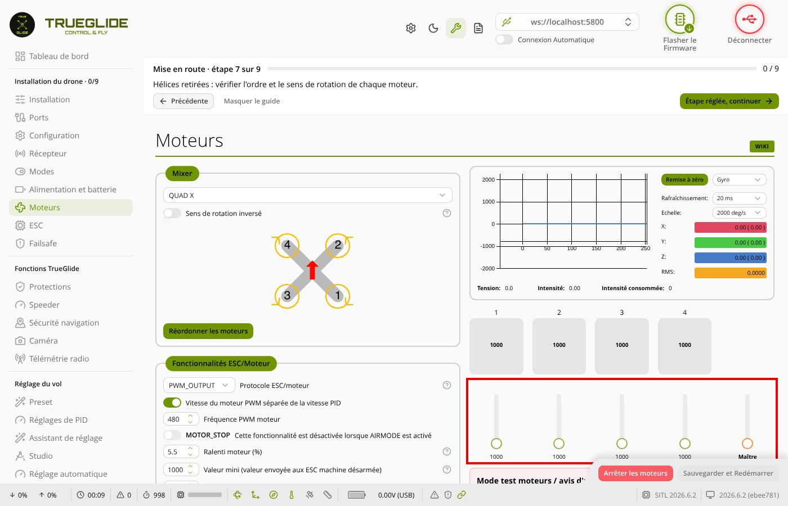

## TG-A1-5B-2. Mode 3D sur oui, test moteurs jamais activé

1. « Mode 3D (nécessite des ESC compatibles) » sur oui. Puis « Sauvegarder et Redémarrer ». « Connexion », onglet Moteurs.

- Aucun moteur n'a bougé, ni au clic, ni pendant le redémarrage ? (c'est le cas du défaut du 07/11 ; danger : moteur
  qui démarre)
- Les 4 cases affichent maintenant 1500, RPM 0 ? (on vérifie que la carte est en 3D et à l'arrêt)

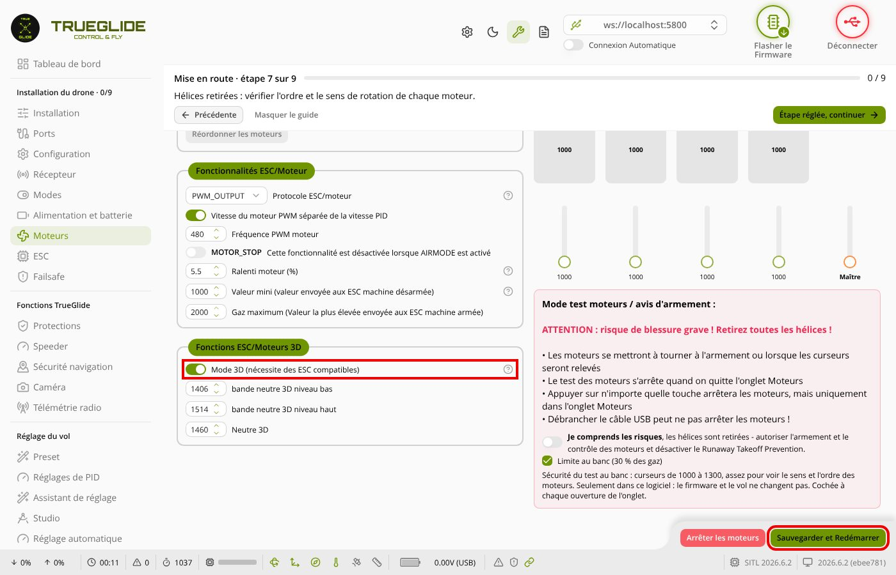

## TG-A1-5B-3. Mode 3D sur non, test moteurs jamais activé

1. « Mode 3D » sur non. « Sauvegarder et Redémarrer ». « Connexion », onglet Moteurs.

- Aucun moteur n'a bougé ? Les 4 cases affichent 1000, RPM 0 ? (danger : moteur qui démarre)

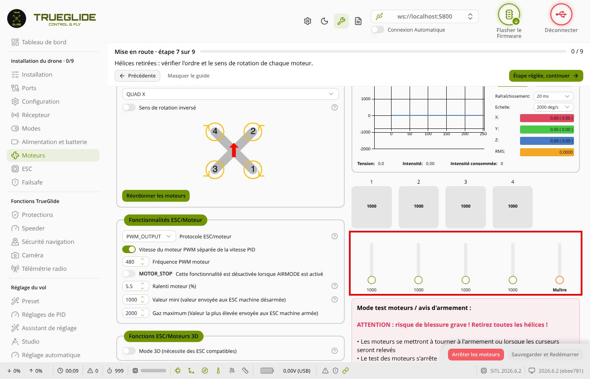

## TG-A1-5B-4. Activer le test moteurs (sans 3D)

1. « Je comprends les risques… » sur oui. Ne pas toucher aux curseurs.

- L'écran dit « curseurs de 1000 à 1300 », aucun moteur ne bouge, RPM 0 ? (on vérifie la limite au banc et que
  l'activation n'envoie que l'arrêt)

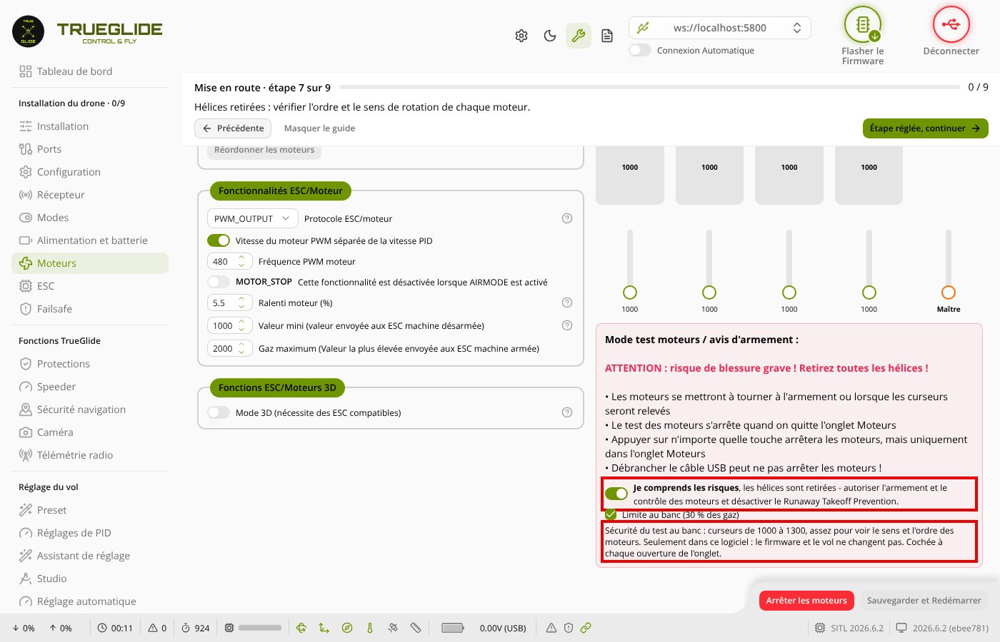

## TG-A1-5B-5. Monter le curseur Maître vers 1100

1. Tirer le curseur « Maître » à la souris jusqu'à environ 1100 (pas la molette).

- Les 4 moteurs tournent doucement. Noter les RPM des 4 moteurs : …… / …… / …… / …… (on vérifie que le test marche)

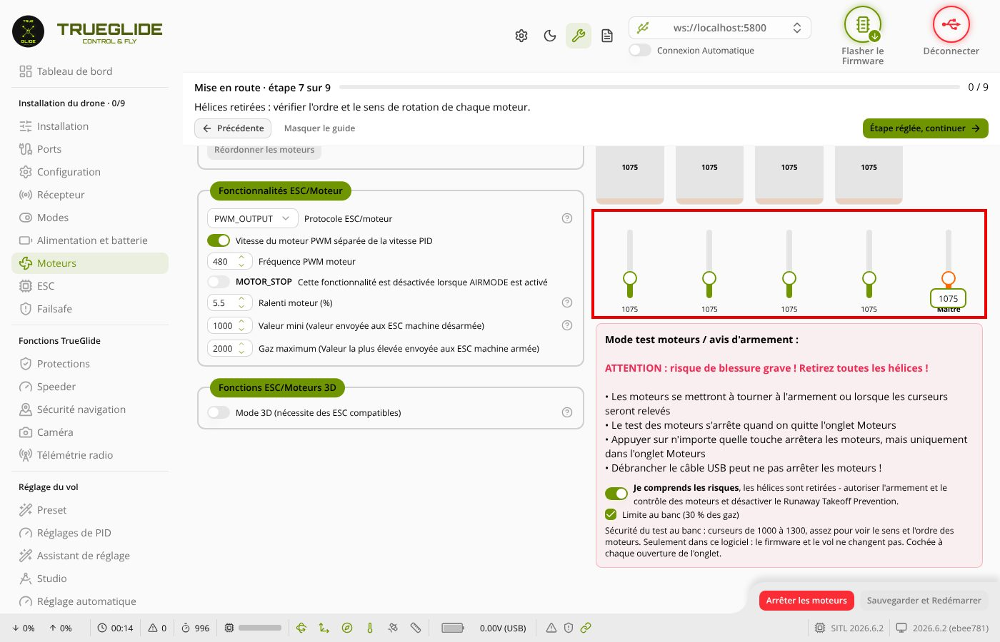

## TG-A1-5B-6. Couper le test

1. « Je comprends les risques… » sur non.

- Les 4 moteurs s'arrêtent tout de suite, RPM 0, et **aucune** fenêtre « la carte n'a pas confirmé l'arrêt » ? (on
  vérifie l'arrêt et sa relecture ; danger : moteur qui continue)

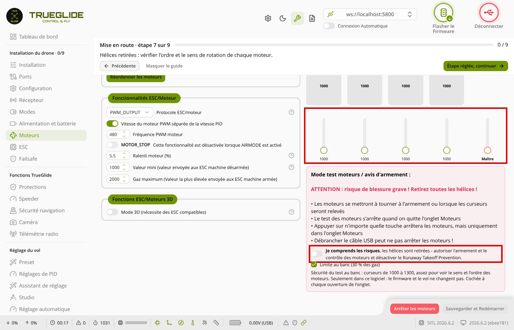

## TG-A1-5B-7. Mode 3D sur oui après avoir utilisé le test

1. « Mode 3D » sur oui. « Sauvegarder et Redémarrer ». « Connexion », onglet Moteurs.

- Aucun moteur n'a bougé ? Les 4 cases affichent 1500, RPM 0 ? (c'est exactement la manipulation du défaut ; danger :
  moteur qui démarre)

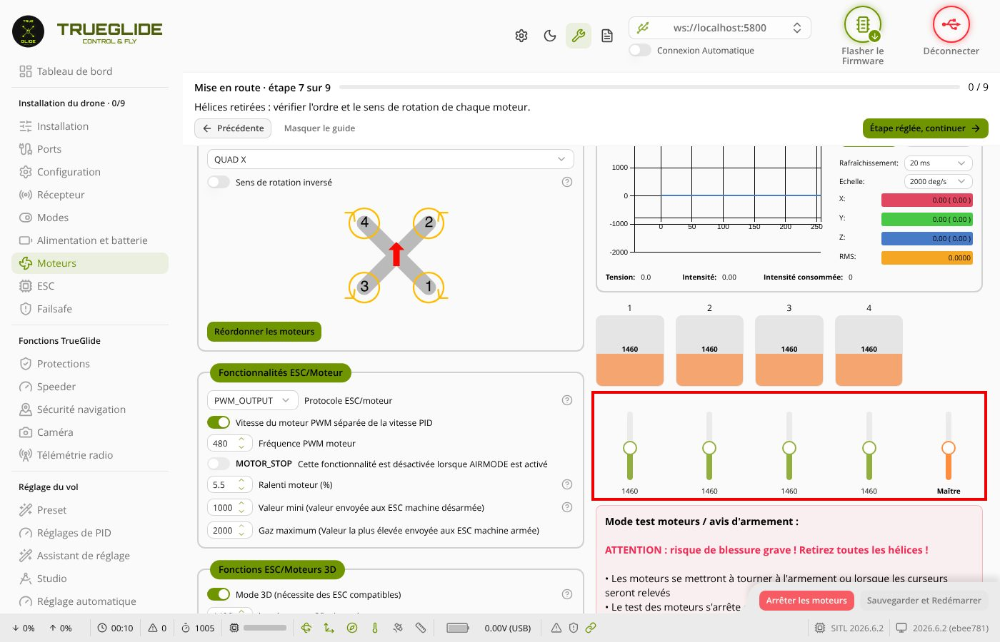

## TG-A1-5B-8. Activer le test en 3D, sans toucher aux curseurs

1. « Je comprends les risques… » sur oui. **Ne pas toucher aux curseurs** (tes ESC ne sont pas en 3D). Attendre 10 s.
   Puis « Je comprends les risques… » sur non.

- Pendant les 10 s, curseurs au milieu (1500), « curseurs de 1350 à 1650 », aucun moteur ne bouge, RPM 0 ? (on
  vérifie que l'arrêt envoyé en 3D est bien 1500 ; danger : moteur qui démarre)

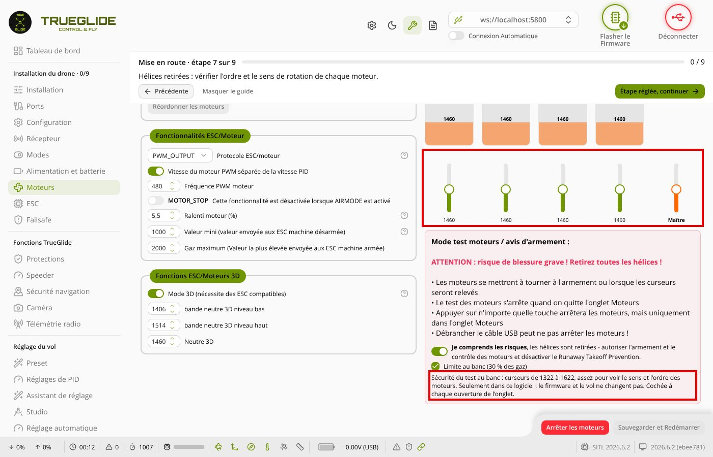

## TG-A1-5B-9. Mode 3D sur non après le test

1. « Mode 3D » sur non. « Sauvegarder et Redémarrer ». « Connexion », onglet Moteurs.

- Aucun moteur n'a bougé ? Les 4 cases affichent 1000 et « Mode 3D » est sur non ? (danger : marche arrière à fond)

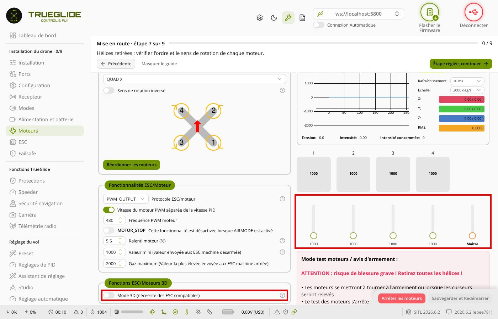

## TG-A1-5B-10. Quitter l'onglet pendant que les moteurs tournent

1. « Je comprends les risques… » sur oui. Curseur « Maître » vers 1100 (moteurs qui tournent).
2. Cliquer sur l'onglet « Configuration » à gauche. Puis revenir sur Moteurs.

- Les moteurs s'arrêtent dès le clic sur Configuration ? Au retour, test sur non, RPM 0 ? (danger : moteurs qui
  continuent hors de l'onglet)

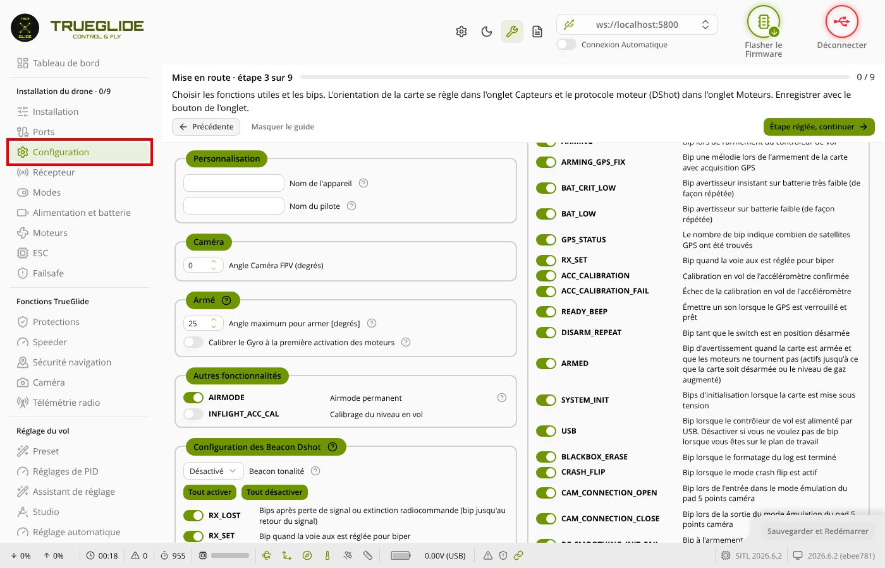

## TG-A1-5B-11. Cacher la page pendant que les moteurs tournent

1. « Je comprends les risques… » sur oui, curseur « Maître » vers 1100.
2. Ouvrir un nouvel onglet du navigateur (Ctrl + T). Revenir sur TrueGlide.

- Les moteurs se sont arrêtés à l'ouverture du nouvel onglet ? Au retour, test sur non ? (danger : moteurs qui tournent
  sans surveillance)

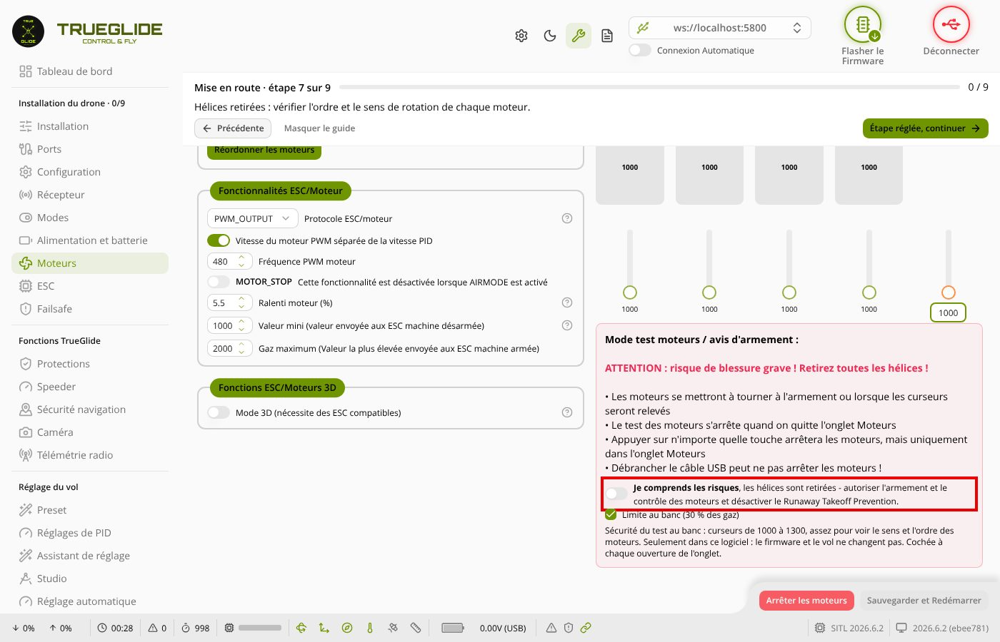

## TG-A1-5B-12. Fenêtre « Réordonner les moteurs »

1. Bouton « Réordonner les moteurs ». Ne rien activer dans la fenêtre. « Annuler ».

- Aucun moteur n'a bougé à l'ouverture ni à la fermeture ? (on vérifie que la fenêtre n'envoie rien tant qu'on ne l'a
  pas autorisée ; danger : moteur qui démarre)

## TG-A1-5B-13. USB débranché pendant que les moteurs tournent (Walksnail branché)

Lunettes Walksnail allumées (la vidéo parle à la carte par un autre port : c'est ce qui est contrôlé).

1. « Je comprends les risques… » sur oui, curseur « Maître » vers 1100.
2. Débrancher le câble USB. Compter.

- Les moteurs se sont arrêtés seuls en 1 à 2 secondes ? (au simulateur : 1,1 s ; danger : moteurs qui continuent
  tant que la batterie est branchée → la débrancher)

## TG-A1-5B-14. Fin (batterie débranchée)

1. Débrancher la batterie. Rebrancher l'USB, « Connexion ». Onglet CLI : `diff all`, Entrée, « Enregistrer sous ».

- Le `diff all` est envoyé (je le compare à celui du départ : seul le firmware doit changer) ?
