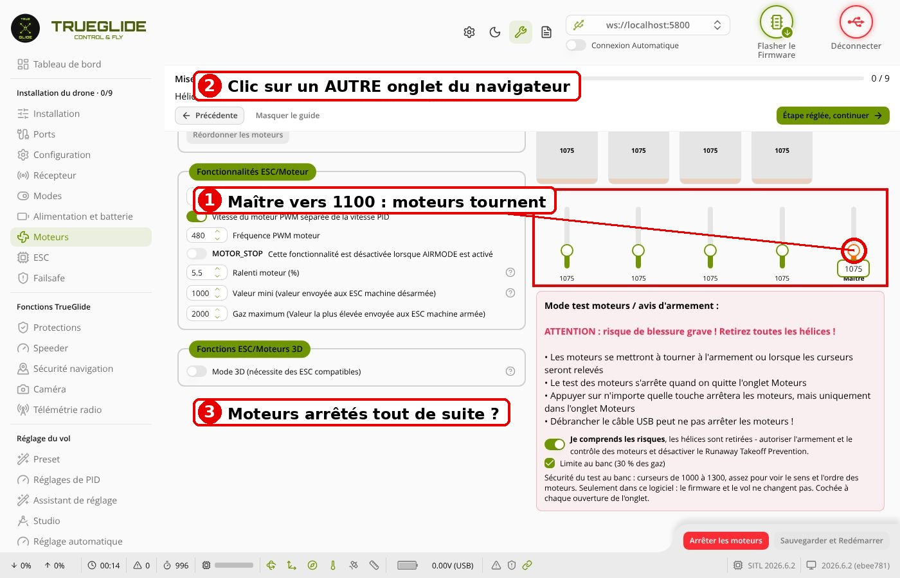
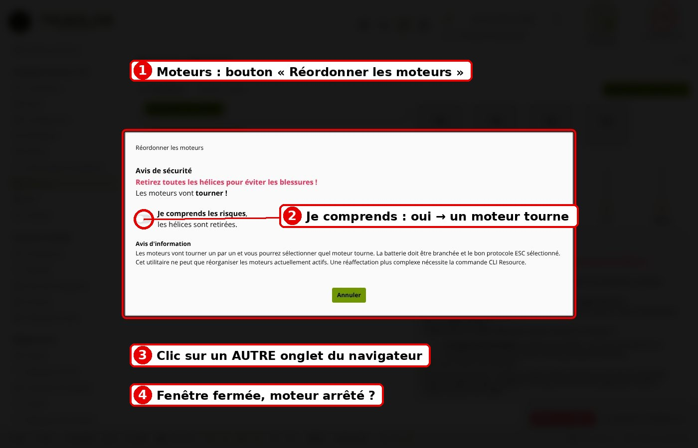
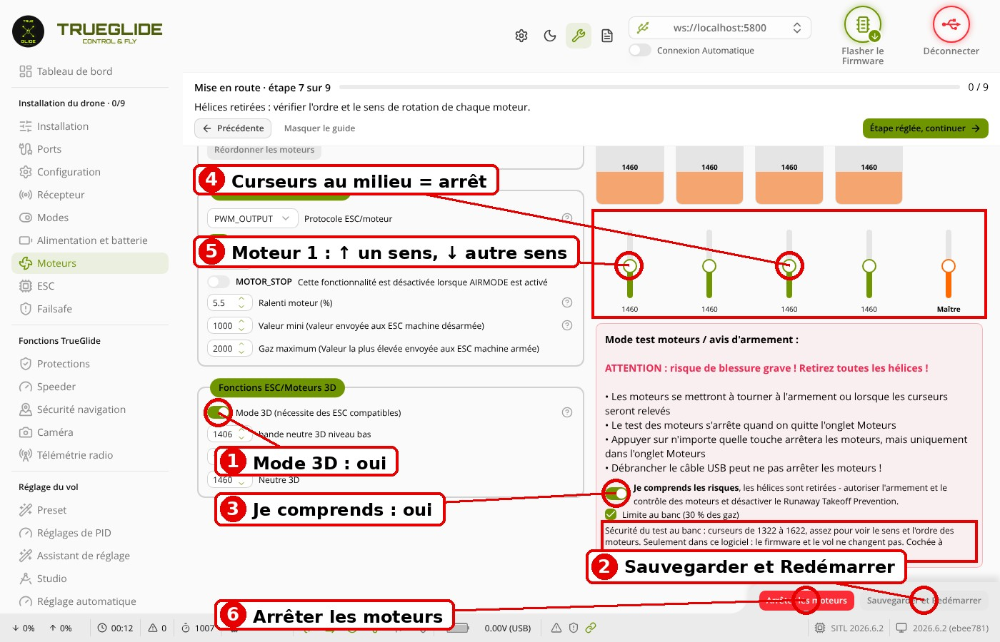

# Essai TG-A1-7 : tests moteurs restants et mode 3D (firmware ee050eb, logiciel 94634f0)

Date : …… Drone : Mini Pouce …… Fait par : ……

**HÉLICES RETIRÉES, drone fixé.** Page /app/. Curseur tiré à la souris. Si un moteur ne s'arrête pas : **débrancher la
batterie tout de suite**. À faire AVANT de remettre la carte en Betaflight.

## TG-A1-7A. Page cachée (mode normal)

1. Onglet Moteurs, batterie branchée, « Je comprends les risques » sur oui.
2. Maître vers 1100 : les moteurs tournent.
3. Cliquer sur un autre onglet du navigateur.

- À l'étape 3, les 4 moteurs se sont arrêtés tout de suite ?

## TG-A1-7B. Fenêtre « Réordonner les moteurs »

1. Revenir sur TrueGlide, onglet Moteurs. Bouton « Réordonner les moteurs ».
2. « Je comprends les risques » sur oui : un moteur tourne.
3. Cliquer sur un autre onglet du navigateur.

- À l'étape 3, la fenêtre s'est fermée et le moteur s'est arrêté ?

## TG-A1-7C. Mode 3D

1. Batterie débranchée. Onglet ESC : lire les 4 ESC, faire une capture d'écran (sens d'origine).
2. Sens des 4 ESC sur « Bidirectionnel » (si le sens d'origine est inversé : « Bidirectionnel inversé »), écrire.
3. Onglet Moteurs : Mode 3D sur oui, « Sauvegarder et Redémarrer ».
4. Brancher la batterie. « Je comprends les risques » sur oui.
5. Monter un peu le curseur du moteur 1, puis le descendre un peu sous le milieu.
6. « Arrêter les moteurs ».
7. Remettre : Mode 3D sur non, « Sauvegarder et Redémarrer » ; batterie débranchée ; ESC au sens d'origine (capture).

- À l'étape 4, les curseurs sont au milieu (1500) et aucun moteur ne tourne ?
- À l'étape 5, le moteur 1 tourne dans un sens en haut, dans l'autre sens en bas ?
- À l'étape 6, tous les moteurs se sont arrêtés ?
- À l'étape 7, curseurs revenus en bas (1000) et ESC au sens d'origine ?

